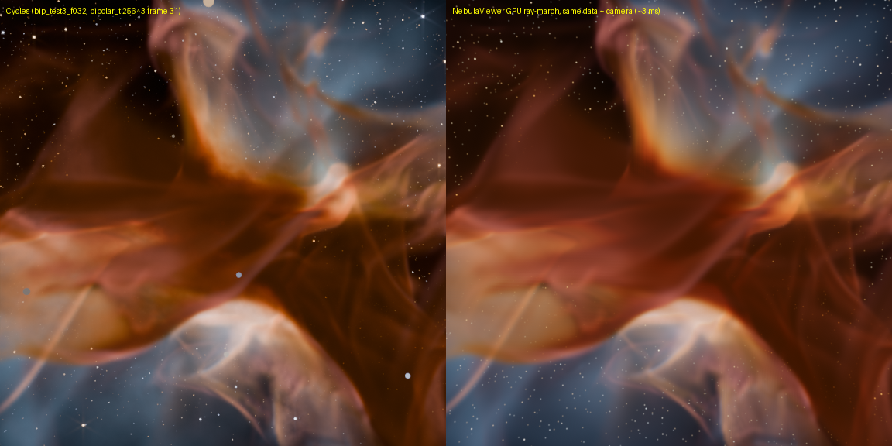

# NebulaViewer — simulador y renderizador de nebulosas en la GPU

[English version](README.md)

Simula una nebulosa de formación estelar (gas, polvo, estrellas jóvenes que la ionizan y la empujan) **y la renderiza en cada cuadro en la GPU**, en una ventana interactiva. Puedes mirar cómo se forma la turbulencia, cómo nacen y se encienden las estrellas y cómo se abren las cavidades. Mientras corre, puedes orbitar la cámara, cambiar parámetros, volver atrás en el tiempo y grabar video.

- Física: `nebula3d.py` (hidrodinámica + transferencia de radiación en NVIDIA Warp), con mejoras propias del viewer (ver "Cómo funciona").
- Render: el mismo modelo del shader **"Nebula Volume"** de Blender (emisión + absorción). Contra Cycles, con los mismos datos y la misma cámara, la diferencia es de 8/255 RMS (`docs/validation_cycles_vs_viewer.png`).



---

## Cómo correrlo

Requisitos: una GPU NVIDIA con driver CUDA reciente, Python 3.10+ (probado con 3.12) y `pip install -r requirements.txt` (warp-lang, numpy, scipy, Pillow, pyglet 2.1 e imageio-ffmpeg, que trae su propio ffmpeg con H.264).

```bat
cd NebulaViewer
python viewer.py                                   :: bipolar 128^3 (o doble clic en NebulaViewer.bat)
python viewer.py --scenario bubbles --res 192      :: burbujas + formación estelar disparada
python viewer.py --scenario cliff --res 256        :: "Cosmic Cliffs": pilares y glóbulos
python viewer.py --width 1920 --height 1080        :: tamaño de la vista 3D (el panel se suma al lado)
```

La ventana tiene tres zonas:

```
+--------------------------------------------+------------------+
|                                            |  PANEL           |
|  vista 3D  (HUD arriba a la izquierda)     |  Simulación      |
|                                            |  Cond. iniciales |
|                                            |  Shader          |
|                                            |  Render / Video  |
+--------------------------------------------+                  |
| |< < > >| ●rec  [=====timeline=====|====]  |  (ayuda al pasar |
| t=0.152 · en vivo         142 cuadros 3 GB |   el mouse)      |
+--------------------------------------------+------------------+
```

### Panel de opciones (Tab lo oculta)

- **Slider:** clic o arrastre para fijar el valor; Shift + arrastre para ajuste fino; clic derecho vuelve al valor por defecto.
- **Selector** (`‹ valor ›`): clic izquierdo pasa al siguiente, clic derecho al anterior.
- Al pasar el mouse sobre un control, abajo del panel aparece qué hace. La interfaz está en inglés.

Secciones:

- **Simulación (en vivo).** Q de la estrella, encendido de la estrella, viento, jets (pulso y período), jets protoestelares, opacidad FUV, turbulencia sostenida y pasos de sim por cuadro. Los cambios actúan en el próximo paso y quedan registrados para el bake.
- **Condiciones iniciales (reinicio).**
  - Escenario y resolución. La resolución es en **celdas por unidad de nebulosa**: el detalle no cambia si agrandas la caja. Debajo se ve cuántas celdas y cuánta GPU va a usar el próximo reinicio.
  - Tamaño del dominio, borde orgánico de la nube y, en bipolar, radio de la nube (ver "La caja y el borde de la nube").
  - Pre-turbulencia: on/off, intensidad, escala, duración.
  - Contraste y espectro del ruido inicial, semilla.
  - Solver y limitador.
  - Parámetros propios de cada escenario: toro, inclinación y envoltura en bipolar; número de burbujas y formación estelar en bubbles; glóbulos y estrellas embebidas en cliff.
  - Los valores cambiados se marcan con `*` en naranjo y se aplican con **Apply and reset** (o R).
- **Shader (Nebula Volume).** Los mismos sockets que en Blender: paleta, tone map, exposición, polvo, emisión, Hα/OIII/SII, PAH, brillo del polvo, choques, G0, detalle, bordes y estrellas. No tocan la sim.
- **Render.**
  - Calidad: filtro del volumen, paso de marcha, escala de render.
  - Movimiento y reproducción: auto-órbita, velocidad de reproducción, loop.
  - Memoria del timeline.
  - Botones: cámara de Blender, encuadrar la caja, captura HQ, bake.
- **Video.** Tamaño, fps, calidad (CRF), modo alta calidad, PNGs, encuadre. Botones: Grabar, Exportar timeline, Órbita 360°.

### Timeline (la barra de abajo)

La sim guarda **snapshots en la GPU** mientras corre (unos 200 sobre la duración del escenario). Con ellos puedes:

- **Arrastrar** sobre la barra para ir a cualquier momento. La zona violeta es la pre-turbulencia (tiempos negativos) y la línea amarilla marca `t_end`.
- **Play** desde el pasado: reproduce lo guardado (a la "velocidad de reproducción" del panel). Al llegar al final sigue simulando en vivo.
- **`<` `>`** (o ← →): cuadro anterior o siguiente. **`|<` `>|`** (o Inicio / Fin): primer cuadro / volver al presente.
- **Ramificar:** si estás en el pasado y cambias un parámetro de la sim (viento, Q, jets…) o das un paso, se descarta el futuro guardado y la sim sigue desde ahí con el cambio. Los cambios de shader nunca ramifican.

Cada snapshot ocupa 13 bytes por celda, porque guarda todo lo necesario para mostrarlo **y** para seguir simulando desde él:

| Grilla | Por snapshot | Snapshots en 8 GB |
|---|---|---|
| 128³ | 27 MB | ~300 |
| 192³ | 92 MB | ~85 |
| bubbles 256 (384×192×256) | 245 MB | ~32 |

Cuando se llena el presupuesto, se descarta un snapshot de cada dos y el espaciado se duplica: el historial completo sigue disponible, con menos cuadros. El presupuesto se cambia con el slider "Memoria del timeline" (1–16 GB) o con `--cache_gb`.

**La sim ya no se pausa al llegar a `t_end`**: corre hasta que la reinicias. El comportamiento antiguo se recupera con `--end_pause`.

### Video

Los videos van a `NebulaViewer\videos\` en **MP4 H.264** (yuv420p, CRF 16 por defecto: listo para redes).

- **● Grabar (F9):** graba cada cuadro nuevo, sea de la sim, de la reproducción del timeline o de un movimiento de cámara. En pausa y sin mover nada no se agregan cuadros. Así puedes:
  - grabar la evolución en vivo (los "pasos por cuadro" controlan la velocidad del timelapse);
  - reproducir el timeline mientras grabas (un cuadro de video por snapshot);
  - pausar y grabar un movimiento de cámara (lo más suave es la auto-órbita).
- **Exportar timeline a video:** renderiza todos los snapshots en orden a un MP4. Funciona muy bien a 128–192³. A 256 caben menos snapshots (~32 en 8 GB), así que para timelapses a alta resolución conviene **grabar en vivo**.
- **Video órbita 360°:** una vuelta completa alrededor del estado actual (duración ajustable).
- **El encuadre:**
  - El video es el **recuadro que no está oscurecido** en la vista 3D, renderizado de nuevo al tamaño elegido (1080p, 1440p, 4K, 1:1, 4:5, 9:16 vertical o el tamaño de la ventana). La ventana puede ser chica y el video, 4K.
  - Mientras graba, el exterior del recuadro se tiñe de rojo.
- **Calidad alta:** filtro tricúbico y paso de 0.5 vóxel. Se ve más suave y cuesta más por cuadro. "Guardar también PNGs" deja la secuencia para editar.

### Teclado

Regla general: **tecla = subir, Shift + tecla = bajar**.

| Tecla | Acción |
|---|---|
| Arrastrar con botón izquierdo / derecho (o Shift + izq.) / rueda | Orbitar / paneo / zoom |
| Espacio, N | Play o pausa, un paso |
| ← → / Inicio, Fin | Cuadro anterior o siguiente del timeline / primero, presente |
| F9 | Grabar o detener video |
| Tab, H, F1, Esc | Panel, HUD, ayuda, salir |
| R | Reinicia (aplica los valores `*` del panel) |
| 1 / 2 / 3 | Escenario bipolar / bubbles / cliff |
| Z (Shift+Z) | Resolución 96 → 128 → … → 800 (reinicia; solo las que caben en la GPU) |
| U | Pre-turbulencia on/off (en el próximo reinicio) |
| `[` `]` o RePág / AvPág | Pasos de sim por cuadro |
| Q / W / J | Q de la estrella / viento / jets |
| D / E / A / G / X | Polvo / emisión / G0 ambiente / saturación de G0 / detalle |
| + / − | Exposición |
| P / T / I | Paleta / tone map / filtro |
| M / V | Paso de marcha / escala de render |
| K / L / O | Spikes / estrellas de fondo / auto-órbita |
| C (Shift+C) | Cámara de Blender (Shift: caja completa) |
| S o F12 (Shift+S) | Screenshot a `media\` (Shift: 2× tricúbico) |
| B | Bake (json + comandos para alta resolución) |

---

## Cómo funciona

### 0. La caja y el borde de la nube

La sim vive en una caja. Si el gas llena la caja hasta las paredes, la región ionizada termina mostrando un rectángulo azul. Eso pasaba en los primeros videos: el cubo en bipolar, el rectángulo azul al final de burbujas y los bordes verticales en pilares. Hay dos arreglos:

- **Dominio más grande:** bipolar 1.6, burbujas y pilares 1.3. En burbujas y pilares crece en x y z (el plano de la imagen). La nebulosa mantiene su tamaño y la caja crece alrededor.
- **Borde orgánico:** la densidad se diluye hasta el piso antes de llegar a las paredes, con un borde irregular (ruido suave de baja frecuencia). La nube queda como un objeto aislado en el espacio. El gas que sale de ella se diluye y su emisión (∝ densidad²) se apaga sola, igual que el "champagne flow" de una región HII real que rompe la nube.

| Escenario | Celdas a res 128 | Celdas a res 256 | GPU a res 256 |
|---|---|---|---|
| bipolar (1.6) | 208³ = 9 M | 408³ = 68 M | ~6 GB |
| burbujas (1.3) | 248×96×168 = 4 M | 496×192×336 = 32 M | ~3 GB |
| pilares (1.3) | 248×112×168 = 5 M | 496×224×336 = 37 M | ~3.4 GB |

- Si una grilla no cabe en la GPU (límite `--max_grid_gb`, 14 GB por defecto), el viewer baja la resolución sola y avisa.
- Con caja 1.0 y borde 0 vuelves al comportamiento de nebula3d.py.

### 1. La nube

La caja parte llena de gas frío y turbulento. La densidad es un campo log-normal con espectro de potencia (igual que las nubes moleculares reales).

Opcionalmente hay una **fase de pre-turbulencia**: el gas se agita a velocidades supersónicas (Mach ~7), con lo que se forman láminas, filamentos y núcleos densos por choques. Esa fase aparece en el timeline con tiempos negativos.

Cada escenario arranca de una geometría distinta:

- **bipolar:** una estrella dentro de un toro denso y una envoltura más densa en el ecuador.
- **bubbles:** una lámina de gas con varias estrellas separadas.
- **cliff:** una pared de nube con glóbulos y estrellas iluminando desde arriba.

### 2. La hidrodinámica

El gas se mueve con las ecuaciones de Euler isotérmicas en una grilla 3D:

- **Esquema:** volúmenes finitos de 2º orden (MUSCL), con dos etapas de Runge-Kutta por paso y el paso de tiempo limitado por la condición CFL.
- **Temperatura del gas:**
  - el gas neutro está a ~100 K;
  - el gas ionizado está a ~10 000 K, con una velocidad del sonido 12 veces mayor, **así que su presión es ~144 veces más alta**.
- **De ahí sale todo el movimiento:** la región ionizada se expande como un pistón y barre el gas neutro, que se acumula en una cáscara densa.

**Solver (nuevo):** el viewer usa por defecto un flujo **HLL** en vez del Rusanov de nebula3d.py.

- **HLL es "upwind":** distingue de dónde viene la información, y por eso difunde mucho menos. Las paredes, los frentes y los dedos de inestabilidad salen más nítidos con la misma resolución.
- **El limitador minmod** evita oscilaciones. Van Leer y MC dan aún más nitidez, pero meten estrías de 2–3 celdas que no son físicas, así que quedan como opción.

### 3. La radiación de las estrellas

- **Ionización (rayos):**
  - Desde cada estrella se lanzan 512×1024 rayos en todas las direcciones.
  - Cada rayo avanza sumando las recombinaciones del gas (∝ densidad²) hasta que se agotan los fotones de la estrella. Ahí queda el **frente de ionización** (la esfera de Strömgren, deformada por la estructura de la nube).
  - Lo que está adentro queda ionizado y caliente.
  - En gas denso el frente se frena: por eso las cavidades tienen forma de burbuja, de reloj de arena o de pilar.
- **FUV:** la luz ultravioleta no ionizante se atenúa por el polvo y calienta la "piel" de las nubes (PDR). Eso es el brillo PAH naranja de las imágenes de JWST.
- **Viento estelar / presión de radiación:** empuje radial (∝ 1/r²) sobre el gas ionizado.
- **Jets:** dos conos estrechos de momento a lo largo del eje de rotación de la estrella. Son pulsantes, y por eso forman nudos (objetos Herbig-Haro).
- **Formación estelar disparada (bubbles):**
  - Donde la cáscara barrida se comprime lo suficiente, nace una estrella nueva, con su propio jet y su propia región HII.
  - Es el mecanismo **"collect & collapse"**: una generación de estrellas dispara la siguiente.

### 4. ¿Por qué las estrellas no "aparecen" de golpe? (nuevo: encendido)

Hay tres escalas de tiempo muy distintas:

| Proceso | Velocidad real | Duración |
|---|---|---|
| La luz y el frente de ionización en gas tenue (fase "R") | cientos a miles de km/s | ~1 000–10 000 años |
| La expansión de la región caliente (fase "D") | velocidad del sonido del gas ionizado, ~10 km/s | 10⁵–10⁶ años |
| El encendido de la estrella misma | crece mientras la protoestrella se contrae hacia la secuencia principal | 10⁴–10⁵ años |

Con una caja de ~10 pc, una unidad de tiempo de la sim es ~1 Myr y un timelapse de 0.25 dura ~250 000 años:

- Que la ionización se vea casi instantánea **es correcto**: dura menos que uno o dos cuadros.
- La presión empuja a la velocidad del sonido, y eso la hidro ya lo hace bien.
- **Lo que no era realista era que la estrella naciera al 100%.** Una estrella masiva nace hinchada y fría; su UV sube por órdenes de magnitud mientras se contrae, y su primera región HII queda atrapada en el núcleo denso donde nació (las regiones HII "hiper/ultra compactas").
- Por eso ahora la Q de cada estrella sube como `smoothstep(edad/encendido)³`. Con eso el radio de Strömgren crece aproximadamente lineal con la edad.
- Por defecto el encendido es 0.02, unos 20 000 años. Ajústalo con **"Encendido de la estrella"**; 0 vuelve al comportamiento antiguo.

### 5. Del gas a la imagen

En cada cuadro, en la GPU:

1. **pack:** los campos (densidad, ionización, distancia al frente, FUV, choques) se convierten en emisión RGB + polvo, con las fórmulas del shader de Blender:
   - Hα = (ρx)² en todo el gas ionizado
   - OIII en la zona interna, cerca de las estrellas calientes
   - SII en la capa justo dentro del frente
   - PAH: polvo × FUV, justo afuera del frente
   - polvo: ρ neutro, con enrojecimiento (absorbe más el azul)
2. **Texture3D:** un volumen RGBA16F con filtrado trilineal por hardware.
3. **ray-march:** cámara orbital, integración exacta por segmento y corte cuando el polvo ya es opaco.
4. **post:** estrellas de fondo atenuadas por el polvo, estrellas jóvenes (núcleo + 6 spikes de JWST, también atenuados), exposición, tone map AgX y dither.

Sin pasar por el disco: la imagen se escribe directo en un buffer de OpenGL (interoperabilidad CUDA-GL).

### 6. Resolución

El costo de la sim crece con ~res⁴: res³ celdas, y además pasos de tiempo más chicos. La resolución es lo que más cambia el resultado: a 256 aparecen los filamentos, los glóbulos con cola y los frentes finos que a 128 se ven como humo.

| Resolución | Uso |
|---|---|
| 128 | interactivo, 4 pasos por cuadro: bipolar 1.6 ~25 fps (8.3 ms/paso), burbujas y pilares 1.3 ~35–40 fps (5.6–6 ms/paso), GPU libre |
| 160–256 | mirar y grabar en vivo, 3–20 fps |
| 288–384 | grabar o hacer bake (lento en vivo: se graba y se mira después en el video o el timeline) |

Medido a res 160 con las cajas nuevas (headless, con tu viewer abierto en paralelo):

| Escenario | Grilla | ms por paso |
|---|---|---|
| bipolar | 256³ | 27 |
| burbujas | 312×120×208 | 18 |
| pilares | 312×144×208 | 12 |

### Archivos

```
viewer.py    ventana + App: estado, panel, timeline, teclas, video, bake, HUD; modo headless
ui.py        panel y barra de timeline dibujados con pyglet (sin dependencias nuevas)
sim.py       Sim: el loop de nebula3d.main() como clase (reset / step / set_param / snapshots)
             + solver HLL, encendido de estrellas, dominio bipolar de cualquier tamaño, ruido "matched"
timeline.py  caché de snapshots en la GPU (fp16), aligerado automático, ramificación
recorder.py  MP4 H.264 con el ffmpeg de imageio-ffmpeg; recorte del encuadre
render.py    pack + ray-march + post (shader Nebula Volume)
bake.py      la misma sim a alta resolución desde un bake json -> frames formato nebula3d
bench.py     tabla de tiempos
```

`nebula3d.py` es el solver original y no se modifica: el viewer importa sus kernels. `crop.py` simula solo una ventana del dominio (por ejemplo, la franja de una toma vertical 9:16). `blender/` trae los scripts de Blender para el bake.

---

## Bake: del preview al render final en Blender

**B** (o el botón del panel) guarda `bakes\bake_<fecha>.json`. Incluye los parámetros, el log de cambios en vivo, las estrellas (también las nacidas por compresión), el look con los nombres de sockets de "Nebula Volume" y la cámara. También imprime dos comandos:

1. **`bake_cmd`** (recomendado): `python bake.py bakes\bake_<fecha>.json --res 384`.
   - Corre la misma clase `Sim`, con el mismo ruido "matched": la **misma estructura grande** que el preview, con más detalle encima.
   - Repite las estrellas y los cambios en vivo, con la transferencia radiativa a calidad completa.
   - Escribe frames en formato nebula3d, que `nebula_preview.py`, `nebula_to_vdb.py` y `build_nebula_scene.py` leen sin cambios. Por defecto quedan en `sim3d\<run>`, donde los buscan `blender/nebula_to_vdb.py` y `blender/build_nebula_scene.py`.
   - ~0.5 GB por frame a 384³.
2. **`nebula3d_cmd`**: el equivalente en `nebula3d.py`.
   - Genera otra realización aleatoria y no repite los cambios en vivo.
   - No tiene las opciones nuevas: dominio, encendido, HLL.

## Rendimiento medido (RTX 3090)

| Caso | Sim | Render |
|---|---|---|
| bipolar 128³, ventana 1280×720 | 64 fps de media (antes del panel) | — |
| bipolar 192³, caja 1.5, HLL, headless | 5.5–6.6 ms/paso | — |
| bubbles 384×192×256, HLL, headless | 21 ms/paso | 12 ms a 1280×860 (t temprano) |

- Las mediciones de bipolar 192³ y bubbles 256 se hicieron **con tu viewer corriendo en paralelo**, así que los números reales son algo mejores.
- **Modo interactivo** (el bake usa la precisión completa):
  - los rayos de ionización avanzan de a 1 vóxel (nebula3d: ½);
  - la ionización se recalcula cada 3 pasos;
  - el FUV, cada 8–16 pasos.
  - Con esto la ionización pasó de ~45% a ~30% del paso a 256.
- En pausa solo se renderiza, así que se puede orbitar a 60–240 fps incluso a 256.

## Limitaciones conocidas

- **Timeline a 256+:** caben pocos snapshots, así que para video conviene grabar en vivo. Se podría duplicar la capacidad guardando el estado completo solo en algunos "keyframes".
- **Jets:** a 128–192³ casi no se resuelven (el radio de lanzamiento es de ~5 celdas). A 256–384 sí.
- **Formación estelar disparada:** baja los campos a la CPU cada 40 pasos, lo que produce un pequeño tirón (~0.1 s a 256).
- **Exportar timeline / órbita:** bloquea la ventana mientras renderiza (el progreso sale en la consola).
- **Render:** no hay scattering real ni bloom (solo spikes analíticos). AgX es una aproximación (~8/255 RMS).
- **Dominio más grande = más celdas:** el detalle se mantiene, pero bipolar 1.6 cuesta ~4× y burbujas/pilares 1.3 ~1.7× respecto de la caja 1.0. Si necesitas velocidad, baja el tamaño del dominio en el panel.

Ver también `GUION_VIDEO.md`: la explicación corta, en formato guion, para acompañar un video.
