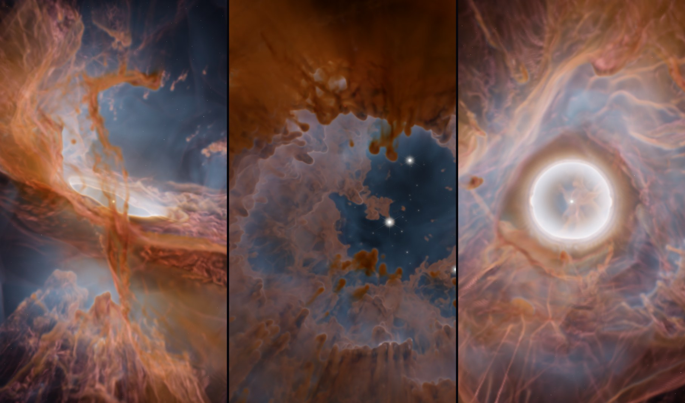
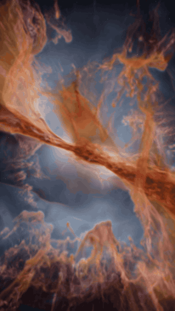
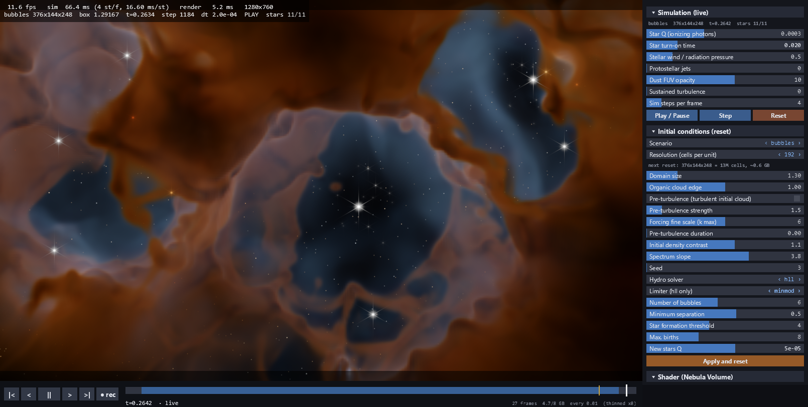

# NebulaViewer

**An interactive GPU simulator and volume renderer for star-forming nebulae**, built on [NVIDIA Warp](https://github.com/NVIDIA/warp).

Cold turbulent gas, young massive stars that ionize it, heat it to 10,000 K and push it around. Cavities, shells, pillars and bipolar outflows come out of the physics, not from hand modeling. The simulation and the renderer share one GPU context, so you watch the nebula form live:
- orbit the camera and change parameters while it runs;
- scrub back in time and branch;
- record 4K or vertical video;
- bake a high-resolution version for Blender.



*Offline 4K renders made with NebulaViewer (sim resolution 320–704). Left: a bipolar nebula. Middle: a star carving a bubble into a turbulent sheet. Right: the same bipolar nebula from above, with its waist ring expanding.*



**What it is:** a toy radiation-hydrodynamics model that is physically motivated and art-directable, meant for artists, educators and anyone curious about how stellar nurseries get their shapes.

**What it is not:** a research code. See [Limitations](#limitations).

[Versión en español](README.es.md)

<br clear="right">

## Features

- **Gas dynamics on the GPU:** isothermal Euler equations, finite volumes with an HLL flux, MUSCL reconstruction and RK2. Neutral gas at ~100 K, ionized gas at ~10⁴ K (~144× the pressure).
- **Starlight:**
  - **Ionization:** ray-traced fronts, i.e. Strömgren spheres shaped by the cloud.
  - **FUV:** a dust-attenuated field for the PDR glow.
  - **Stellar winds.**
  - **Pulsed jets:** they leave Herbig-Haro knots.
  - **Gradual star turn-on.**
  - **Triggered star formation:** in compressed shells ("collect & collapse").
- **Three scenarios:**
  - `bipolar`: a star inside a dense torus, which makes an hourglass nebula.
  - `bubbles`: several stars carving cavities in a turbulent sheet.
  - `cliff`: an ionized cloud wall with globules and pillars.
- **Real-time volume rendering:**
  - emission (Hα, [OIII], [SII], PAH) plus dust absorption with reddening;
  - JWST, Hubble SHO and natural palettes, and an AgX tone map;
  - the same emission model as the Blender "Nebula Volume" shader, within ~8/255 RMS of Cycles on the same data ([comparison](docs/validation_cycles_vs_viewer.png)).
- **GPU timeline:** snapshots while it runs. Scrub, replay, step, and branch from any point by changing a parameter.
- **Video:** H.264 MP4 at any size (1080p, 4K, 1:1, 4:5, 9:16 vertical), 360° orbits, timeline export.
- **Bake to Blender:** `bake.py` re-runs a session offline at high resolution with the same large-scale structure. `blender/` converts the result to OpenVDB and builds a Cycles scene.
- **Memory-lean:**
  - about 48 bytes per cell;
  - optional cropped domains: simulate only the slab a vertical shot sees.
  - On a 24 GB card that means a ~720³ grid for the full bipolar box, or ~700–800 cells per unit for a cropped 9:16 window (offline).

## Requirements

- **GPU:** an NVIDIA GPU with a recent driver (CUDA). Developed on an RTX 3090 (24 GB). 8 GB is enough for the interactive resolutions (128–256).
- **OS:** Windows 10/11 is where it was developed. Linux should work, but is untested. macOS is not supported (no CUDA).
- **Python:** 3.10 or newer, tested with 3.12.

## Quick start

```bash
git clone https://github.com/felipehez/NebulaViewer.git
cd NebulaViewer
pip install -r requirements.txt
python viewer.py                                  # bipolar, res 128
python viewer.py --scenario bubbles --res 192     # bubbles + triggered star formation
python viewer.py --scenario cliff --res 256       # a "Cosmic Cliffs" wall: pillars and globules
python viewer.py --width 1920 --height 1080       # size of the 3D view (the panel is added at the side)
```

- **First run:** Warp compiles the CUDA kernels, which takes about a minute. Later runs use the cache.
- **Resolution:** it is measured in cells per nebula unit, so enlarging the box keeps the same detail. Grids that don't fit in GPU memory are refused before allocating.
- **Help:** hover over any panel control for a description at the bottom of the panel; F1 shows the keys.



## Controls

General rule: **key = up, Shift + key = down**.

| Key | Action |
|---|---|
| Left drag / right drag (or Shift + left) / wheel | Orbit / pan / zoom |
| Space, N | Play or pause, single step |
| ← → / Home, End | Previous or next timeline frame / first frame, back to live |
| F9 | Start or stop recording |
| Tab, H, F1, Esc | Panel, HUD, help, quit |
| R | Restart, applying the panel values marked `*` |
| 1 / 2 / 3 | Scenario bipolar / bubbles / cliff |
| Z (Shift+Z) | Resolution 96 → 128 → … up to what fits on the GPU (restarts) |
| U | Pre-turbulence on/off (on the next restart) |
| `[` `]` or PgUp / PgDn | Sim steps per frame |
| Q / W / J | Star ionizing output / wind / jets |
| D / E / A / G / X | Dust / emission / ambient FUV / FUV saturation / detail |
| + / − | Exposure |
| P / T / I | Palette / tone map / volume filter |
| M / V | Ray-march step / render scale |
| K / L / O | Diffraction spikes / background stars / auto-orbit |
| C (Shift+C) | Default camera (Shift: frame the whole box) |
| S or F12 (Shift+S) | Screenshot to `media/` (Shift: 2×, tricubic) |
| B | Bake: writes `bakes/bake_<stamp>.json` and prints the high-res commands |

### Panel controls

- **Slider:** click or drag sets the value, Shift + drag gives fine control, right click resets it.
- **Selector** (`‹ value ›`): left click goes to the next value, right click to the previous one.
- **Live vs. restart:**
  - Live parameters (star output, wind, jets, …) act on the next step and are logged for the bake.
  - Initial-condition parameters are marked `*` and applied with **Apply and reset** or R.

### Timeline

The sim stores snapshots on the GPU while it runs, about 200 over a scenario, at 13 bytes per cell.
- **Scrub:** drag on the bar to go to any moment. The violet zone is the pre-turbulence phase.
- **Play from the past:** replays the stored frames, then continues simulating live.
- **Branch:** change a sim parameter or step while in the past. The stored future is dropped and the sim continues from there.
- **When the budget fills up:** every other snapshot is dropped, so you keep the whole history with fewer frames. Set the budget with `--cache_gb` or the panel.

### Recording

Videos go to `videos/` as H.264 MP4 (yuv420p, CRF 16).

- **F9:** records every new frame, whether it is live sim, timeline playback or camera motion.
- **Video size:** the clear rectangle in the 3D view is what gets recorded, re-rendered at the chosen size. A small window can record 4K.
- **High quality:** tricubic filtering and half-voxel steps, for slow shots and orbits.

## Bake to Blender

1. **Bake json:** press **B** in the viewer. It writes `bakes/bake_<stamp>.json`, with the parameters, the live-change log, the star list (including triggered births), the look and the camera.
2. **Re-run at high resolution:**

   ```bash
   python bake.py bakes/bake_<stamp>.json --res 384     # -> sim3d/<run>/  (nebula3d-format frames)
   ```

   It is the same `Sim` class with the same "matched" noise, so you get the same large-scale structure as the preview with finer detail on top. It replays the stars and the live changes, and runs full-quality radiative transfer.
3. **Convert and render in Blender** (5.x; `nebula_to_vdb.py` needs Blender's bundled `openvdb` module):

   ```bash
   blender -b --factory-startup --python blender/nebula_to_vdb.py -- <run>
   blender -b --factory-startup --python blender/build_nebula_scene.py -- <run> --palette jwst
   ```

## How it works

**The cloud.**
- The box starts filled with cold, turbulent gas: a log-normal density field with a power-law spectrum.
- An optional pre-turbulence phase stirs it supersonically (Mach ~7), so shocks build sheets, filaments and dense cores before any star turns on.

**Hydrodynamics.**
- The gas follows the isothermal Euler equations, with a sound speed that depends on the ionized fraction.
- The HLL flux keeps walls, fronts and instability fingers much sharper than the original Rusanov flux at the same resolution.
- The minmod limiter is the default. Van Leer is sharper, but can striate.

**Radiation.**
- **Ionization fronts:**
  - Each star casts rays and accumulates recombinations (∝ n²) until its ionizing photons run out. That is the ionization front: a Strömgren sphere deformed by the cloud.
  - Gas inside it is hot and pushes like a piston. Dense clumps slow the front and cast shadows, which is how pillars form.
- **FUV:** non-ionizing UV, attenuated by dust, lights the PDR skin. This is the orange PAH glow in JWST images.
- **Star turn-on:** a star's output ramps up over ~10⁴ years instead of appearing at full power, as massive protostars do.

**Time and length scales.**
- With a box of ~10 pc, one sim time unit is ~1 Myr, so a 0.25 timelapse covers ~250,000 years.
- The R-type ionization front crosses tenuous gas within a frame or two, which is correct. The D-type expansion at ~10 km/s is the slow motion you see.

**From gas to image (every frame, on the GPU).**
1. **Pack:** the fields (density, ionization, distance to the front, FUV, compression) become RGB emission plus dust in an RGBA16F 3D texture.
2. **Ray-march:** exact per-segment integration, with early exit once the dust is opaque.
3. **Post:** background stars dimmed by dust, star spikes, exposure, AgX and dither.
4. **Display:** the image goes straight to an OpenGL buffer through CUDA-GL interop.

## Resolution and performance

The sim cost grows roughly with res⁴: res³ cells, and smaller time steps. Resolution is what changes the look the most. At 256, filaments, tailed globules and thin fronts appear that look like smoke at 128.

| Resolution | Use (RTX 3090) |
|---|---|
| 128 | Interactive: bipolar ~25 fps, bubbles and cliff ~35–40 fps (4 steps per frame) |
| 160–256 | Watch and record live, 3–20 fps |
| 288–800 | Record or bake offline. Use `--set "crop=[x0,x1,y0,y1,z0,z1]"` to simulate only the window a shot sees |

How much memory each grid needs, how far each scenario goes on a 12, 16 or 21 GB card, cropped domains and the Windows page-file caveat: see [docs/memory.md](docs/memory.md).

## Limitations

- **Simplified physics:**
  - two-temperature isothermal gas, with no real heating or cooling;
  - no self-gravity and no magnetic fields;
  - on-the-spot ionization;
  - dust that just follows the gas.
  It is good for shapes and intuition, not for quantitative science.
- **Jets:** barely resolved below res 256.
- **Timeline at high resolution:** at 256+ only a few snapshots fit, so record live instead.
- **Exports:** exporting the timeline or an orbit blocks the window while it renders.
- **Rendering:** no real scattering and no bloom (only analytic spikes). The AgX tone map is an approximation.

## Files

```
viewer.py      window + App: state, panel, timeline, keys, video, bake, HUD; headless mode (--headless)
ui.py          panel and timeline bar drawn with pyglet
sim.py         Sim: reset / step / live parameters / snapshots; HLL solver, star turn-on, matched noise
nebula3d.py    the original Warp kernels and initial conditions (imported by sim.py, unmodified)
crop.py        cropped domains (simulate only the window a shot sees)
timeline.py    GPU snapshot cache (fp16), thinning, branching
render.py      pack + ray-march + post ("Nebula Volume" model)
recorder.py    H.264 MP4 through imageio-ffmpeg; recording frame crop
bake.py        offline high-resolution re-run of a bake json -> nebula3d-format frames
bench.py       timing table
blender/       nebula_to_vdb.py (frames -> OpenVDB) and build_nebula_scene.py (Cycles scene)
```

## Credits and license

Created by Felipe ([@felipehez](https://github.com/felipehez)), developed with Claude Code.

Licensed under the [Apache License 2.0](LICENSE).

Third-party dependencies keep their own licenses:
- NVIDIA Warp: Apache-2.0
- NumPy and SciPy: BSD
- Pillow: MIT-CMU
- pyglet: BSD
- imageio-ffmpeg: BSD-2. It downloads an FFmpeg binary, which is LGPL/GPL.
